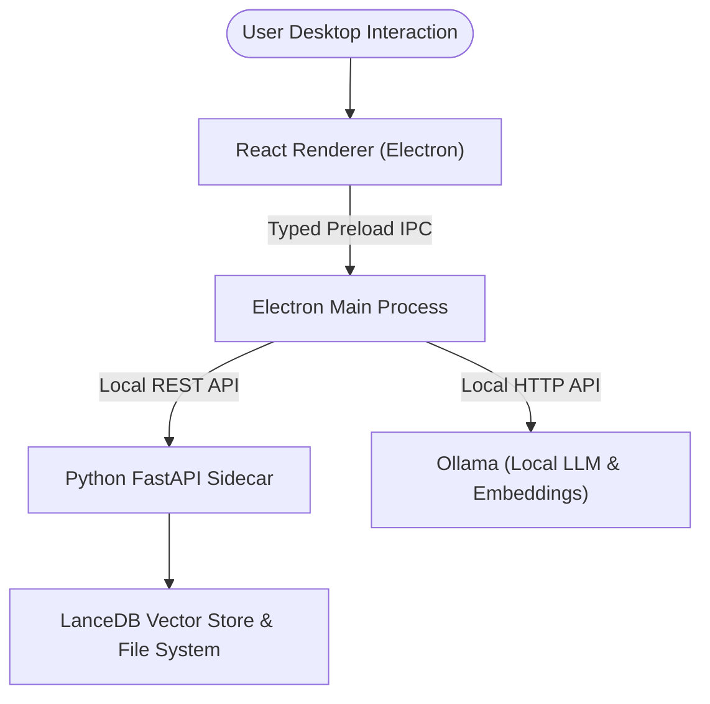
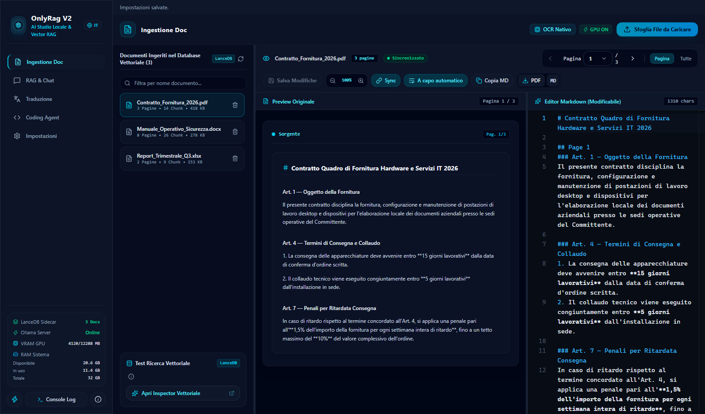
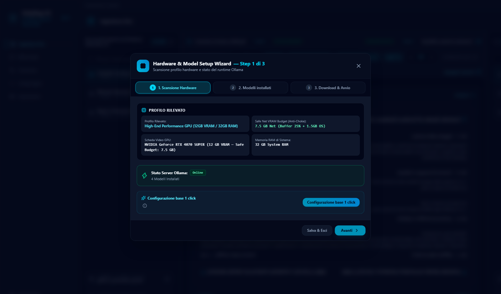
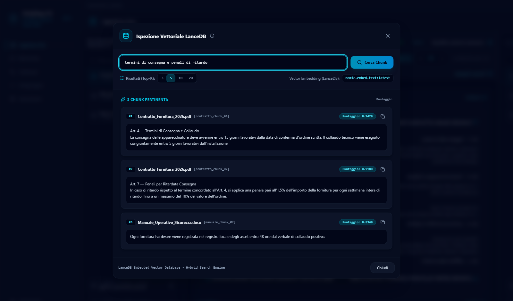
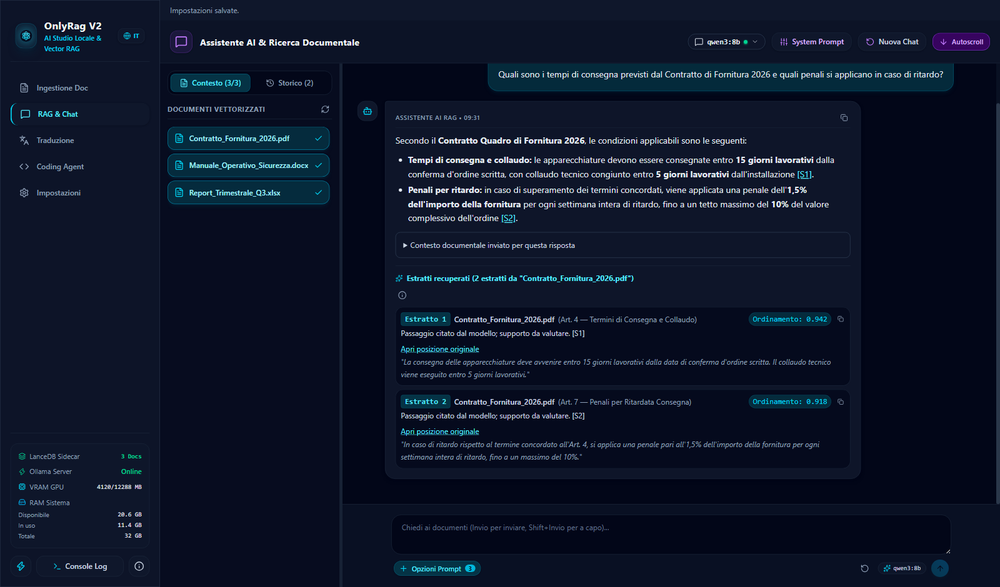
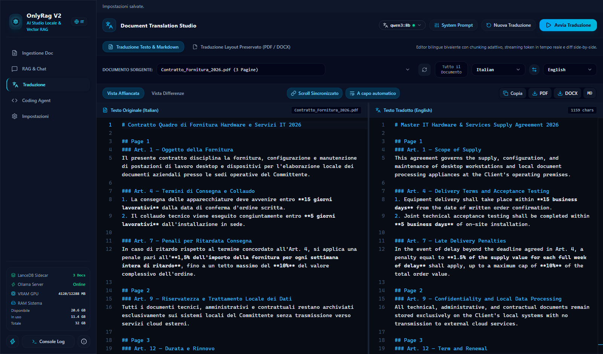
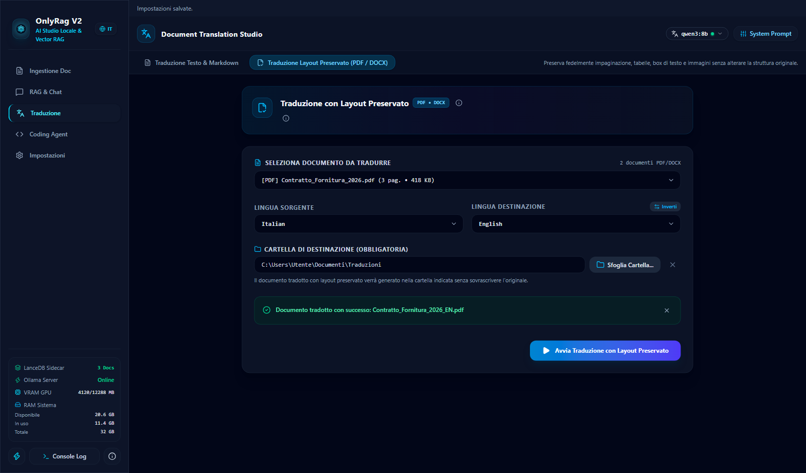
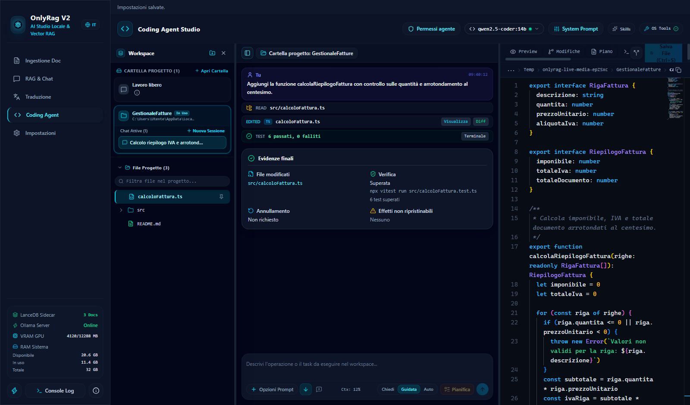
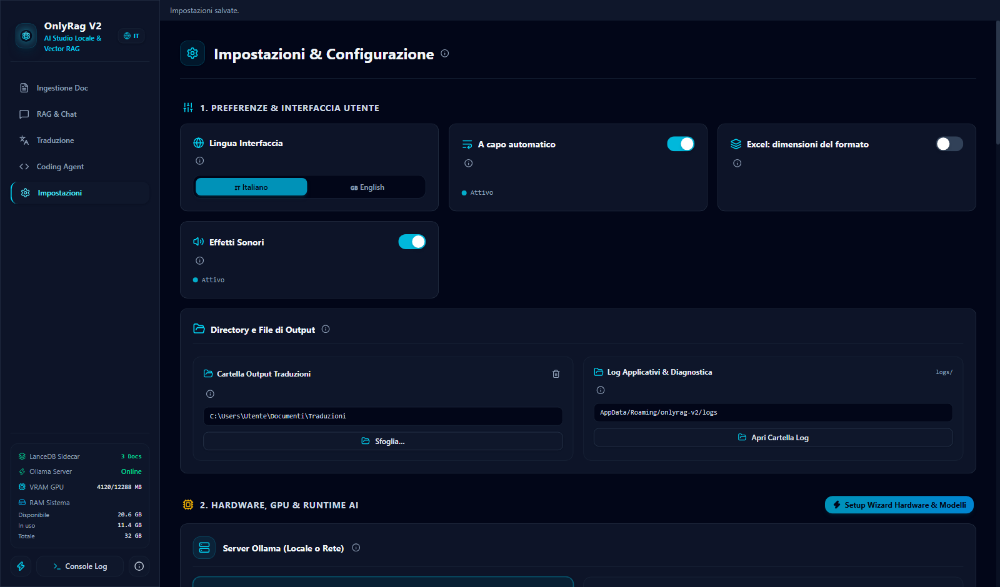
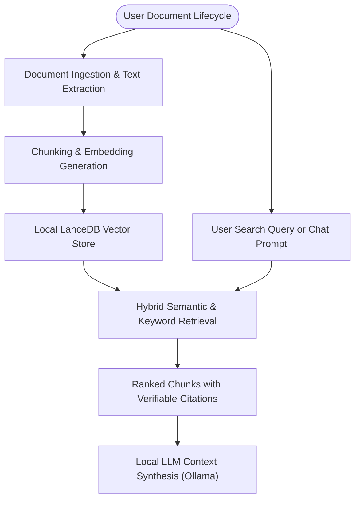

# OnlyRag V2

A local Windows desktop workspace for multi-format document ingestion, offline RAG retrieval, document translation, and coding-agent workflows. Powered by local Ollama models, local LanceDB vector storage, and an isolated Python Sidecar service.

Development currently targets a working local Windows app. [Local policy and autonomous tests](./docs/local-development-policy-2026-10-20.md): no model qualification campaigns or automatic CI; optional smoke tests use only models manually configured in the app. Public installer delivery is outside this phase.

---

## Architecture

OnlyRag V2 separates concerns across isolated processes to guarantee stability, security, and responsive UI rendering:



- **React Renderer**: Modern desktop interface targeting Windows 1080p, running in an isolated web context without direct Node.js or filesystem access.
- **Electron Preload & IPC**: Strictly validated runtime contracts using Zod schemas to ensure type-safe inter-process communication ([`shared/ipc/ipcContract.ts`](./shared/ipc/ipcContract.ts)).
- **Main Process**: Application lifecycle, window management, local configuration, system diagnostics, and background task management.
- **Python Sidecar**: FastAPI service managing document parsing, OCR pipelines, text chunking, and LanceDB persistence ([`sidecar/main.py`](./sidecar/main.py)).
- **Ollama Runtime**: Local LLM and embedding server ensuring 100% offline data privacy without cloud telemetry.

---

## Core Workflows & Visual Tour

### 1. Document Ingestion & Multi-Format OCR
Ingest PDF, DOCX, images (PNG, JPG, TIFF), text files, and tabular data with OCR extraction and immediate Markdown preview.



### 2. Guided Model Setup & Role Allocation
Dedicated configuration wizard assigns local Ollama models to specialized roles: Chat, Translation, Coding, and Embeddings.



### 3. Local Semantic & Hybrid Retrieval
LanceDB vector indexing with cosine similarity, keyword matching, exact chunk provenance, and relevance scoring.



### 4. Offline RAG Chat with Grounded Citations
Interact with documents through a conversational interface with transparent source citations and expandable context snippets.



### 5. Document & Markdown Translation
Translate Markdown files directly or perform in-place document translation preserving layout structure, complete with live streaming progress.





### 6. Coding Agent Studio
Full-featured coding workspace with step-by-step plan approval, Monaco diff view, versioned edits, controlled PowerShell tooling, Git inspection, and verification gates.



### 7. Diagnostics, System Settings & Model Management
Monitor real-time hardware status (CPU, RAM, GPU/VRAM), manage local models, and configure workspace preferences.



---

## Ingestion & Retrieval Pipeline



---

## Quick Start

### Prerequisites
- **OS**: Windows 10/11 64-bit (desktop target: 1080p).
- **Node.js**: `>=24.19.0 <25`
- **npm**: `>=11 <12`
- **Python**: `3.13.15`
- **Ollama**: Installed and running locally with your desired models (e.g., `nomic-embed-text`, `qwen2.5-coder`, `llama3.2`).

### Installation and Launch

```powershell
# Clone the repository
git clone https://github.com/dennidalpos/OnlyRagV2.git
cd OnlyRagV2

# Set up local dependencies (Node packages and Python venv)
npm run setup:dev

# Start the application in development mode with hot reload
npm run dev
```

For development, operational maintenance, profiling, packaging, and safe cleanup commands, refer to [`docs/operations.md`](./docs/operations.md).

---

## Documentation Map

Detailed technical documentation is organized by domain in [`docs/README.md`](./docs/README.md):

| Domain / Audience | Guides |
| --- | --- |
| **End Users** | [User Guide (Guida Utente)](./docs/guida-utente.md) |
| **Operations & Setup** | [Operations & Toolchain](./docs/operations.md) |
| **Architecture & Structure** | [Architecture](./docs/architecture.md), [Frontend Renderer](./docs/frontend.md), [Electron Main](./docs/electron-main.md) |
| **Process Contracts** | [Typed IPC Contract](./docs/api-ipc.md) ([`shared/ipc/ipcContract.ts`](./shared/ipc/ipcContract.ts)), [REST API](./docs/api-rest.md) ([`sidecar/main.py`](./sidecar/main.py)) |
| **Ingestion, RAG & Translation** | [Ingestion & OCR](./docs/ingestion.md), [Retrieval & Embeddings](./docs/retrieval.md), [Translation](./docs/translation.md) |
| **Coding Agent** | [Agent Overview & Boundaries](./docs/coding-agent.md), [Agent Runtime](./docs/agent-runtime.md), [Guards](./docs/agent-guards.md), [Diagnostics](./docs/agent-diagnostics.md) |
| **Models & Sizing** | [Hardware Runtime Fit](./docs/model-runtime-fit.md) |
| **Verification & History** | [Current Verification](./docs/verification-current.md), [Historical Evidence](./docs/history.md) |

---

## Verification & Quality Gates

The project enforces deterministic offline checks and gates:

```powershell
# Run frontend Vitest test suite
npm run test

# Run critical Python offline gates (admission, search, persistence)
npm run quality:python

# Verify documentation links, anchors, scripts, and Mermaid blocks
npm run docs:check

# Run static quality and IPC consistency analysis
npm run quality:static
```

---

## Repository Map

```text
assets/     High-resolution screenshots, icons, and public visual assets
docs/       Technical guides, architectural blueprints, and user documentation
electron/   Main process, IPC handlers, application services, and infrastructure
scripts/    Setup, validation, test suites, and packaging automation
shared/     Cross-process types, IPC contracts, and domain models
sidecar/    FastAPI service, LanceDB storage, OCR engines, and document parsing
skills/     Local agent development skills
src/        React desktop frontend (UI components, hooks, stores, and styles)
```

---

## Limits & Target Boundaries

- **Form Factor**: Desktop Windows 1080p target only. Mobile and tablet viewports are intentionally outside the application target.
- **Privacy & Connectivity**: Operates fully offline; models run locally via Ollama. No remote telemetry, external tracking, or mandatory internet connectivity.
- **Development Phase**: Focuses on architecture simplification, core performance, and local reliability. Standalone installer distribution and public cloud services are outside the scope of this phase ([`docs/local-development-policy-2026-10-20.md`](./docs/local-development-policy-2026-10-20.md)).

---

## License & Third-Party Credits

- **Project Code**: Licensed under the MIT License; see [`LICENSE`](./LICENSE).
- **Third-Party Components**: Bundled libraries and standalone CPU runtime terms are documented in [`DISTRIBUTION-LICENSE.md`](./DISTRIBUTION-LICENSE.md), [`docs/distribution-cpu-release.md`](./docs/distribution-cpu-release.md), and [`docs/distribution-licenses.md`](./docs/distribution-licenses.md).
