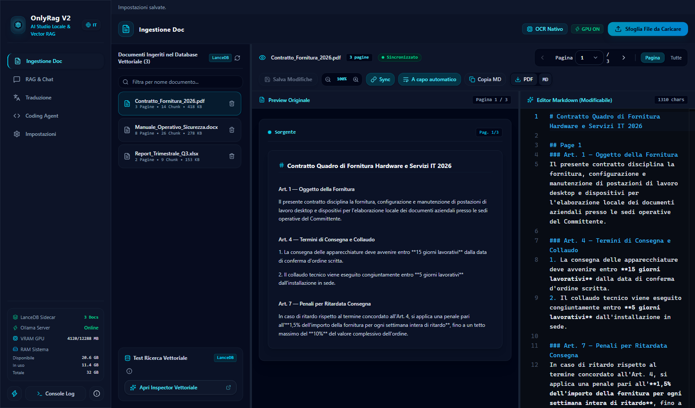
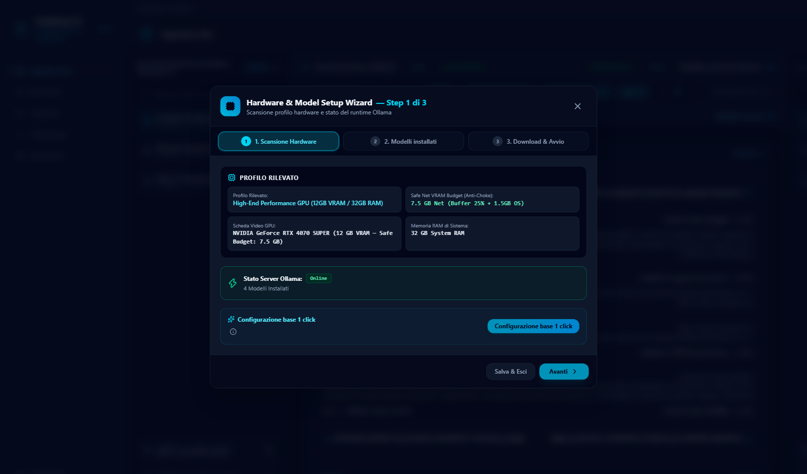
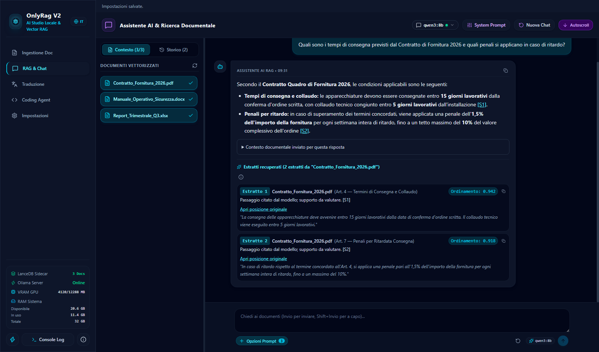
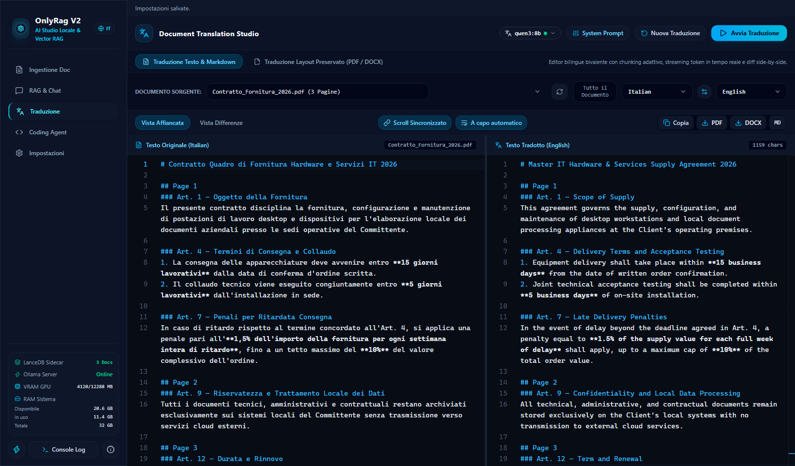
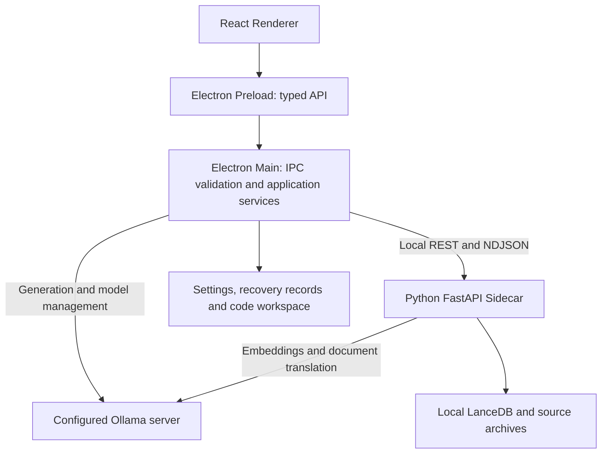
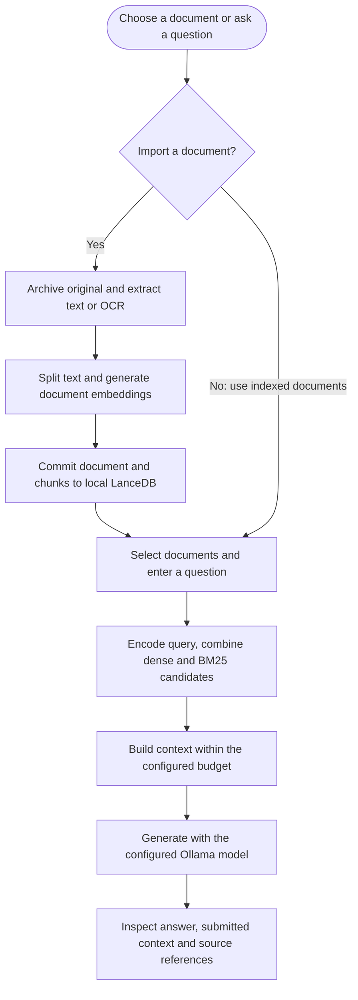

# OnlyRag V2

A Windows desktop workspace for document ingestion, retrieval-augmented chat, translation, and coding tasks. React runs inside Electron; a Python Sidecar extracts documents and stores their text and vectors in local LanceDB. Ollama supplies generation and embeddings.

Use it to inspect extracted text, ask questions across selected documents, compare translations, or work on a code folder with an agent. The interface is available in Italian and English.

The current development phase targets a working local Windows app. Public installer delivery and automatic CI are outside this phase; see the [local development policy](./docs/local-development-policy-2026-10-20.md).

## What you can do

| Task | Implemented workflow | Details and limits |
| --- | --- | --- |
| Import and review | Extract PDF, DOCX, supported images, text, and tabular files; inspect the original preview alongside editable Markdown. | [Ingestion and OCR](./docs/ingestion.md); table extracts are bounded and unsupported DOCX structures can be refused. |
| Search and ask | Combine dense retrieval and BM25, inspect ranked chunks, and chat with selected documents and source references. | [Retrieval](./docs/retrieval.md); scores rank candidates and citations still need review. |
| Translate | Stream a text/Markdown translation or create a separate translated PDF/DOCX through the layout workflow. | [Translation](./docs/translation.md); incomplete output cannot be exported and layout preservation has format-specific limits. |
| Work on code | Open a workspace, use Ask, Guided, or Auto, inspect diffs, run permitted commands, and review verification results. | [Coding Agent](./docs/coding-agent.md); changes affect the workspace and Stop keeps edits already made. |
| Configure models | Inspect hardware and assign installed Ollama models to chat, translation, coding, and embedding roles. | [User guide](./docs/user-guide.md); memory estimates do not guarantee that a model will fit. |

## Visual tour

These are existing captures of the Electron app from **22 October 2026**, using an isolated demonstration profile with synthetic documents and controlled scenario data. They illustrate the interface, not new model-quality or hardware benchmarks. See [capture provenance and limitations](./docs/assets/screenshot-provenance.md).

### Inspect documents



### Configure Ollama models



### Review answers and sources



### Compare a translation



## Quick start from source

Run the commands in PowerShell. Prerequisites come from [package.json](./package.json), [.nvmrc](./.nvmrc), [.python-version](./.python-version), and the [setup script](./scripts/setup_dev_environment.ps1).

| Requirement | Supported configuration |
| --- | --- |
| OS | Windows x64; desktop interface targets 1080p. |
| Node.js | `>=24.19.0 <25` (repository pin: `24.19.0`). |
| npm | `>=11 <12`. |
| Python | Python 3.13.x discoverable through `py -3.13` or `python` (repository pin: `3.13.15`). |
| Ollama | A running server and installed models appropriate to the roles you configure. Default endpoint: `http://127.0.0.1:11434`. |

```powershell
git clone https://github.com/dennidalpos/OnlyRagV2.git
cd OnlyRagV2
npm run setup:dev
# Continue only after setup succeeds.
npm run dev
```

`setup:dev` installs npm dependencies from the lockfile, prepares Electron, and installs Python development requirements in `.venv`. It needs network access for missing dependencies, including GPU runtime libraries, and can recreate an incompatible `.venv`; review existing local environments first. Verify `node --version`, `npm --version` and `py -3.13 --version` before setup. The setup script checks Node/Python but does not separately enforce the npm range.

On first launch:

1. Open **Settings / Impostazioni** and check the Ollama endpoint and service status.
2. Use the hardware/model wizard or model assignment controls to select installed generation and embedding models. Generation stops with an explicit error if no usable model is configured.
3. Import a small document in **Ingestione Doc** and review its extraction.
4. Select the document in **RAG & Chat**, ask a question, then inspect the submitted context and source references.

See [English setup, diagnostics, and recovery](./docs/developer-guide.md) for service failures and development commands.

## Architecture and data flow



The Renderer has no direct Node.js or filesystem access. Main validates requests through the [IPC contract](./shared/ipc/ipcContract.ts); the Sidecar handles [document REST operations](./sidecar/main.py). Ollama is local by default, and a remote endpoint can be configured.



The diagram shows the successful path; [ingestion](./docs/ingestion.md), [retrieval](./docs/retrieval.md), and the [user guide](./docs/guida-utente.md) describe refusals and recovery.

## Local operation and limits

- **Connectivity:** local models and storage support local document workflows once dependencies and models are installed. Setup, model downloads, skill hubs, and permitted agent web tools can access the network. Selecting a remote Ollama endpoint sends model requests to that server; this is not an unconditional offline guarantee.
- **Network policy:** the agent exposes `offline-strict`, `local-only`, and `network-approved` profiles. The settings default is `network-approved`; inspect the active profile and permissions before running a task. See [agent guards](./docs/agent-guards.md).
- **Document fidelity:** extraction, translation, and generated answers require review. Ranking scores are not confidence probabilities. DOCX preview represents extracted content, and translated layout is not qualified for every document.
- **Stored originals:** removing a document from the index retains its archived original. Deletion from the index is not a purge; see [source archive lifecycle](./docs/retrieval.md#ciclo-di-vita-degli-archivi-originali).
- **Agent changes:** Stop leaves existing edits in place. Checkpoints retain attributed files, empty directories and verified internal links, with snapshot limits; they do not reverse every shell action or external effect. Inspect diffs and recovery evidence before restoring. Unsaved code-editor drafts survive workspace switches in memory, but not app exit.
- **Workspace formats:** new code workspaces initialize the current metadata layout. Previous/unversioned layouts and v1 checkpoints are refused with originals retained; Standalone does not automatically transfer previous standalone history. See [workspace and recovery behavior](./docs/user-guide.md#coding-agent-workspaces-and-plans-flows-1416).
- **Platform and release:** Windows desktop is the target. Historical test and installer results apply to their recorded revisions; they do not certify the current checkout or a new installer.

## Documentation

The [documentation index](./docs/README.md) separates task guides, implementation contracts, and dated reference material. The English user/developer guides cover maintained workflows; Italian visual/technical originals and dated receipts remain linked for detail.

| Audience / goal | Read |
| --- | --- |
| Use the app | [English user guide](./docs/user-guide.md) · [Italian visual guide](./docs/guida-utente.md) |
| Develop and troubleshoot | [English developer/operations guide](./docs/developer-guide.md), [architecture](./docs/architecture.md), [Renderer](./docs/frontend.md), [Main](./docs/electron-main.md) |
| Inspect process contracts | [Typed IPC](./docs/api-ipc.md), [REST](./docs/api-rest.md) |
| Work on document features | [Ingestion](./docs/ingestion.md), [retrieval](./docs/retrieval.md), [translation](./docs/translation.md) |
| Work on the agent | [Usage and boundaries](./docs/coding-agent.md), [runtime](./docs/agent-runtime.md), [guards](./docs/agent-guards.md), [diagnostics](./docs/agent-diagnostics.md) |
| Understand verification and packaging | [Recorded verification](./docs/verification-current.md), [local distribution](./docs/distribution.md), [historical index](./docs/history.md) |

## Development checks

Run the checks appropriate to your change. They are local commands; listing them here does not claim they all passed for this documentation revision.

```powershell
npm run docs:check
npm run format:check
npm run typecheck
npm run quality:static
npm run test
npm run quality:python
```

`docs:check` checks local links, anchors, npm script names, and the supported Mermaid flowchart syntax and graph structure. It does not render diagrams, check remote URLs, or prove application behavior. `quality:python` runs critical offline Python cases and rejects missing/skipped cases; it is separate from the full backend suite. See [operations](./docs/operations.md#comandi) for the complete commands and verification boundaries.

## Support and license

For a problem, consult [operations](./docs/operations.md) and [agent diagnostics](./docs/agent-diagnostics.md), then open an [issue](https://github.com/dennidalpos/OnlyRagV2/issues) with your revision, tool versions, reproduction steps, and sanitized diagnostics. Review logs and screenshots for document contents, local paths, and credentials before sharing them.

Project source is licensed under [MIT](./LICENSE). Bundled components, models, and distribution candidates have separate terms: see [DISTRIBUTION-LICENSE.md](./DISTRIBUTION-LICENSE.md) and [distribution licenses](./docs/distribution-licenses.md).
