# Guida visiva ai flussi di OnlyRag V2

**Cosa vuoi fare?** Parti dalla mappa 00 e segui i numeri dei percorsi. I nomi in grassetto corrispondono ai comandi dell’interfaccia italiana. Ogni diagramma è seguito dagli stessi passaggi in testo.

Guida confrontata con viste, hook, testi italiani e decisioni approvate il **22 ottobre 2026**. I percorsi derivano dall'esame del codice; le prove native già eseguite hanno date e limiti propri nello [stato delle verifiche](./verification-current.md). La guida non certifica la qualità dei modelli o ogni build installata.

## Indice

| Obiettivo | Percorsi |
|---|---|
| Scegliere la funzione | [00 · Cosa vuoi fare?](#00-cosa-vuoi-fare) |
| Preparare l’ambiente | [01 · Primo utilizzo](#01-primo-utilizzo-e-servizi) |
| Importare e gestire documenti | [02–07 · Ingestione Doc](#ingestione-doc) |
| Fare domande e controllare le fonti | [08–10 · RAG & Chat](#rag--chat) |
| Tradurre documenti | [11–13 · Traduzione](#traduzione) |
| Analizzare o modificare codice | [14–20 · Coding Agent](#coding-agent) |
| Configurare l’app | [21–25 · Impostazioni](#impostazioni) |

## Come leggere i diagrammi

**Rettangolo:** azione da compiere nell’interfaccia. **Rombo:** scelta o controllo dell’esito. **Forma arrotondata:** punto di partenza, risultato da verificare o rimando a un altro percorso (`→ numero`). Le frecce delle decisioni riportano **Sì / No**; segui soltanto il ramo che corrisponde al tuo caso. Una riprova è una nuova azione esplicita, non un ciclo automatico.

Ogni percorso presenta il diagramma **Mermaid** seguito dalla figura **SVG** locale e dalla sequenza testuale equivalente. Per consultare la guida offline anche senza un lettore compatibile con Mermaid conserva il file Markdown insieme alla cartella `assets/flussi-utente/`: ogni figura mantiene i testi selezionabili e include titolo e descrizione accessibili.

## 00 Cosa vuoi fare?

**Prerequisiti.** Scegli il tuo obiettivo; se è il primo avvio, segui prima il percorso 01.

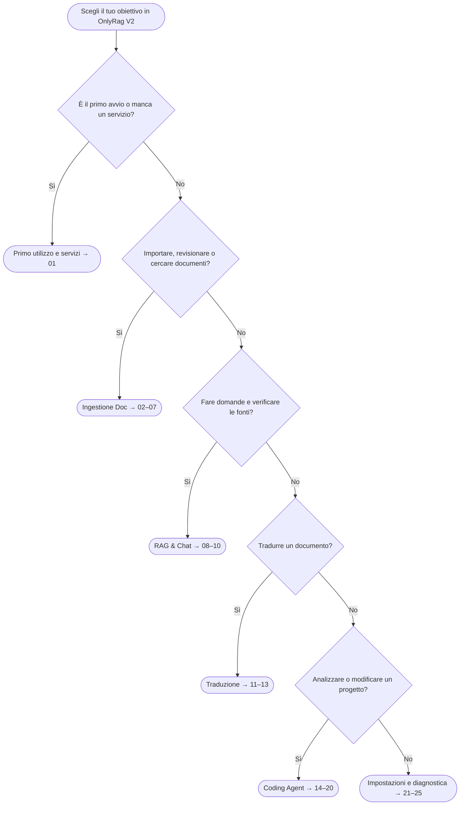


**Percorso testuale.**

1. Al primo avvio o se un servizio risulta non disponibile, prepara l’ambiente nel percorso 01.
2. Per importare, revisionare, esportare o cercare documenti: **Ingestione Doc**, percorsi 02–07.
3. Per conversare e verificare le fonti: **RAG & Chat**, percorsi 08–10.
4. Per cambiare lingua a un documento: **Traduzione**, percorsi 11–13.
5. Per analizzare o modificare un progetto: **Coding Agent**, percorsi 14–20.
6. Per configurare ambiente, modelli, permessi e log: **Impostazioni**, percorsi 21–25.

## 01 Primo utilizzo e servizi

**Prerequisiti.** OnlyRag V2 aperto; file e modelli necessari disponibili sul dispositivo o sul server scelto.

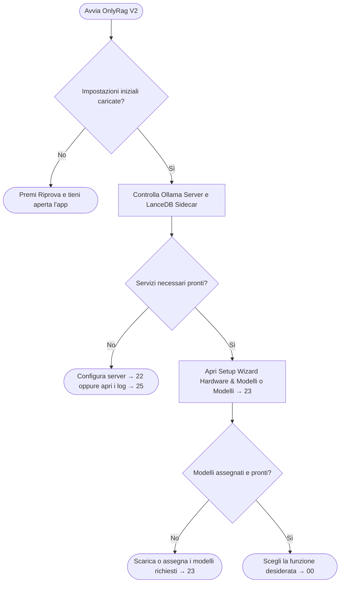


**Percorso testuale.**

1. Se compare un errore di lettura delle impostazioni, usa **Riprova**. Il file originale non viene sostituito e la diagnostica automatica resta sospesa.
2. Controlla **Ollama Server** per le generazioni e **LanceDB Sidecar** per le operazioni documentali. Se un servizio manca, segui 22 o consulta i log in 25.
3. Usa **Setup Wizard Hardware & Modelli** o assegna i modelli in 23; quindi torna alla funzione desiderata.

**Da sapere.** Il download iniziale di modelli e l’installazione di Ollama richiedono accesso alla rete. Il lavoro con runtime locale e risorse già disponibili può avvenire offline. Un server remoto riceve i dati delle richieste: scegli consapevolmente il percorso 22.

Durante la preparazione del Sidecar la barra laterale mostra **Verifica...**; attendi l'esito prima di trattarlo come offline. Gli aiuti delle opzioni si aprono con mouse o focus da tastiera; Escape chiude prima l'aiuto e poi l'eventuale dialogo. Il wizard applica le proposte solo con la conferma o **Salva ed esci**: chiuderlo con X/Escape lascia le assegnazioni precedenti.

## Ingestione Doc

### 02 Importare un documento

**Prerequisiti.** LanceDB Sidecar disponibile, file salvato su disco; OCR e modelli configurati in 23.

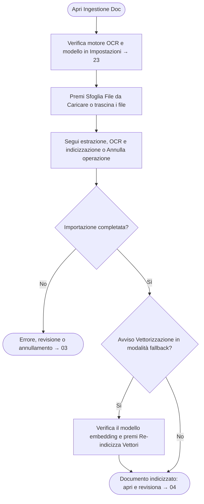


**Percorso testuale.**

1. Scegli **OCR Nativo (RapidOCR / ONNX)** oppure **Vision LLM Multimodale (Ollama Vision)** nelle Impostazioni. Con Vision, seleziona un modello compatibile; il selettore rapido e **System Prompt** sono disponibili anche nella vista di ingestione. Con OCR Nativo il badge indica **GPU ON**, **GPU Presente (ONNX CPU)** o **CPU**.
2. Premi **Sfoglia File da Caricare** o trascina file locali. Più file vengono elaborati in sequenza. Annullare la selezione non avvia l’importazione.
3. Segui estrazione, OCR e indicizzazione. **Annulla operazione** richiede l’interruzione: attendi il messaggio finale, senza considerare completo un task annullato.
4. Con esito positivo il documento compare nell’elenco: se compare **Vettorizzazione in modalità fallback:**, verifica il modello di embedding e usa **Re-indicizza Vettori**; poi passa a 04. Con errore controlla il messaggio e i servizi prima di riprovare; se appare una revisione, passa a 03.

**Da sapere.** Il caricamento corrente disattiva la normalizzazione LLM: non c’è una scelta “Controllo Testo” attiva in questo percorso. L’originale non viene modificato. Per file tabulari, l’estratto destinato al RAG può omettere righe, colonne o celle: controlla le indicazioni di copertura; “Excel: dimensioni del formato” non equivale a indicizzazione integrale.

### 03 Revisione ed errori di importazione

**Prerequisiti.** Un’importazione ha segnalato un errore o il pannello “Normalizzazione: revisione richiesta”.

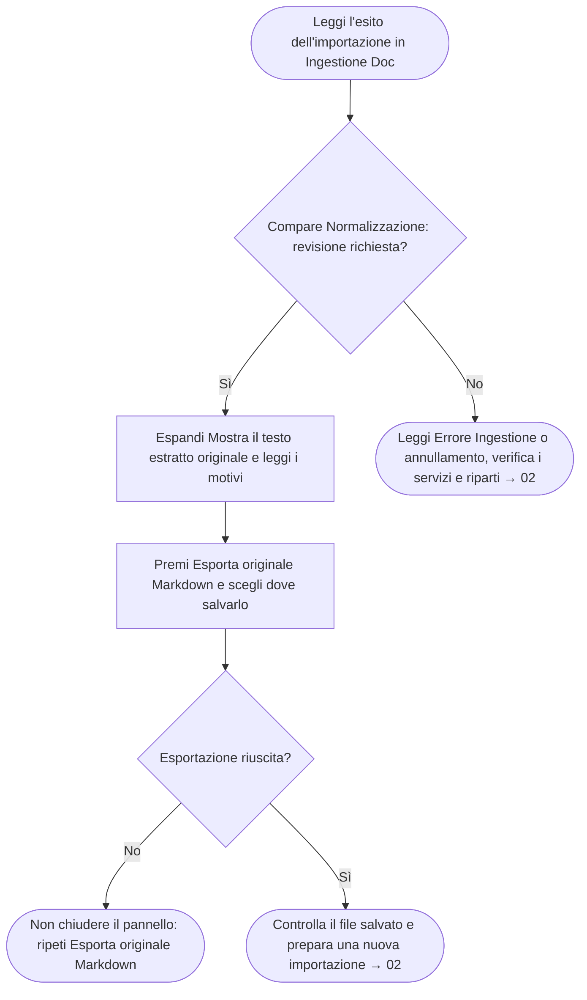


**Percorso testuale.**

1. Se compare **Normalizzazione: revisione richiesta**, espandi **Mostra il testo estratto originale** ed esamina i motivi segnalati.
2. Usa **Esporta originale Markdown**; controlla che l’esportazione sia riuscita prima di chiudere il pannello. Annullare il salvataggio non conserva una nuova copia.
3. Questa bozza non è salvata né indicizzata. Il pannello consente lettura ed esportazione, non l’approvazione o l’indicizzazione diretta: conserva il testo e prepara una nuova importazione dopo la revisione.
4. Con un errore ordinario correggi la causa indicata; dopo un annullamento verificato puoi avviare una nuova importazione da 02.

**Da sapere.** È un percorso condizionale di recupero: l’importazione normale corrente non attiva la normalizzazione LLM. Chiudere il pannello non salva il testo e non certifica la fedeltà dell’estrazione.

### 04 Revisionare e salvare il testo

**Prerequisiti.** Un documento indicizzato selezionato e testo Markdown caricato.

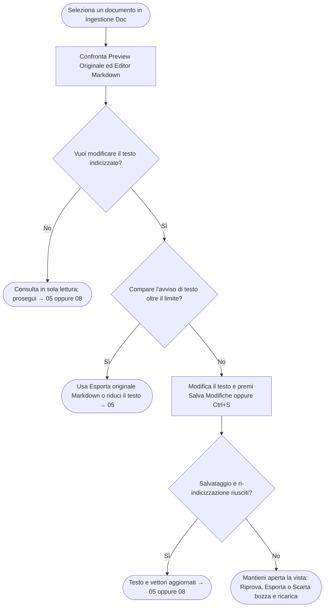


**Percorso testuale.**

1. Seleziona un documento; usa pagine, zoom, **Sync** e **Tutte / Pagina** per confrontare **Preview Originale** ed **Editor Markdown (Modificabile)**.
2. Se serve correggere e il testo rientra nei limiti, modifica il Markdown e premi **Salva Modifiche** o **Ctrl+S**. Il salvataggio aggiorna anche i vettori usati dalla ricerca. Se il testo supera il limite di modifica, usa **Esporta originale Markdown** o riducilo prima di salvare.
3. Attendi la conferma di salvataggio. Con errore di salvataggio o di recupero bozze conserva aperta la vista: usa **Riprova**, **Esporta** (percorso 05) oppure **Scarta bozza e ricarica** dopo conferma. Se non modifichi il testo, prosegui direttamente a esportazione o chat.

**Da sapere.** Le correzioni riguardano il testo indicizzato, non il file originale. Le bozze vengono conservate separatamente dal documento salvato e riproposte dopo riavvio con la revisione originale. Un avviso di recupero fallito offre **Riprova** ed esportazione; la chiusura normale resta bloccata se le nuove modifiche non sono state conservate. Dopo un errore di salvataggio, **Scarta bozza e ricarica** richiede conferma e carica il documento salvato più recente. Esporta prima ciò che vuoi conservare: una lettura fallita o nuove battute durante l'attesa mantengono la bozza. Un arresto forzato può perdere le ultime battute non ancora confermate; la perdita di alimentazione non è qualificata.

### 05 Copiare o esportare un documento

**Prerequisiti.** Un documento selezionato con testo disponibile nell’editor.

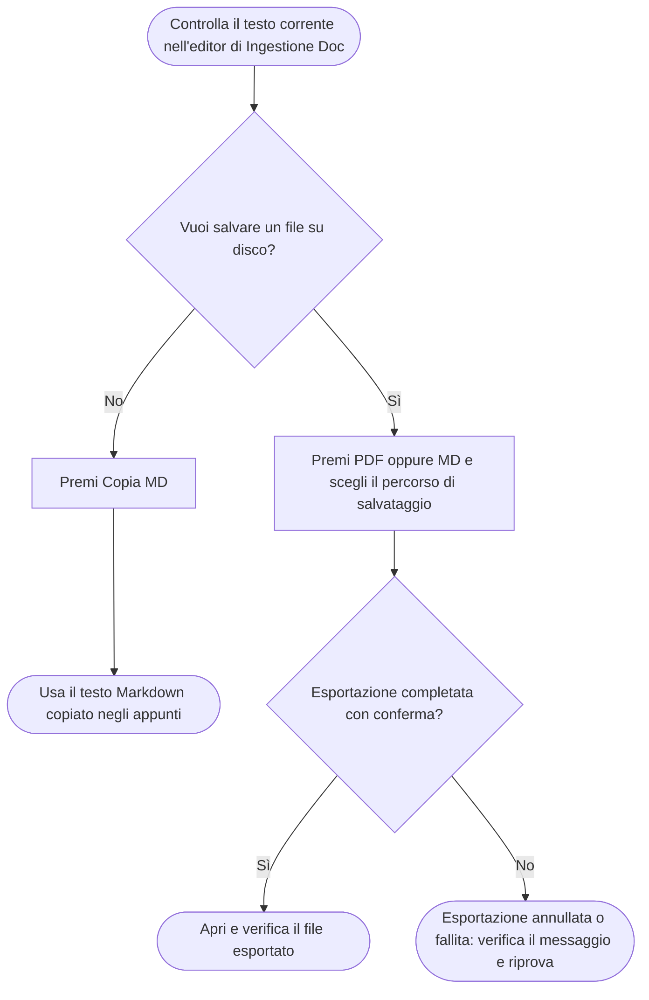


**Percorso testuale.**

1. Per usare gli appunti premi **Copia MD**; per creare un file scegli **Esporta PDF** o **Esporta Markdown**.
2. L’esportazione usa il contenuto corrente dell’editor, anche se modificato. Segui il dialogo di salvataggio e attendi l’esito.
3. Se annulli o ricevi un errore, non considerare la copia salvata: riprova. Con esito positivo apri il file e controllalo; il salvataggio nel database resta un’azione separata, descritta in 04.

**Testi molto grandi.** Un documento preesistente oltre 10 milioni di unità UTF-16 resta leggibile. Usa **Esporta Markdown** per conservarlo integralmente; per salvarlo nell'indice o convertirlo occorre ridurre il testo. L'export non risolve un errore di conservazione della bozza né sblocca da solo la chiusura.

### 06 Cercare nei passaggi indicizzati

**Prerequisiti.** Documenti indicizzati e LanceDB Sidecar disponibile.

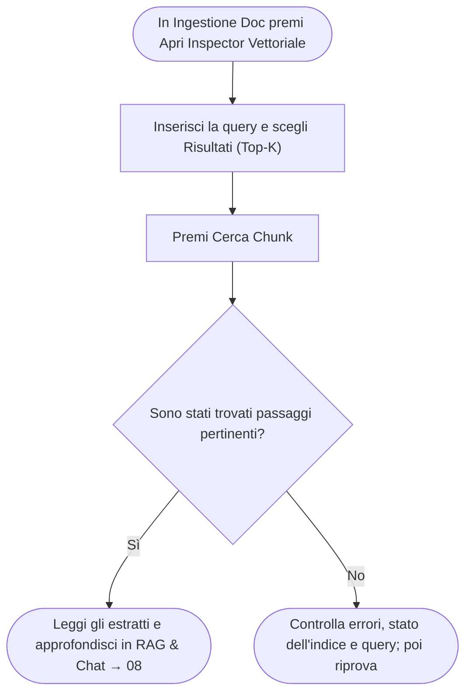


**Percorso testuale.**

1. In **Ingestione Doc**, sotto **Test Ricerca Vettoriale**, premi **Apri Inspector Vettoriale**.
2. Inserisci una domanda o termini di ricerca, scegli 3, 5, 10 o 20 risultati e premi **Cerca Chunk**. L’inspector cerca nell’indice: il filtro per nome della lista documenti non limita questa ricerca.
3. Leggi i passaggi recuperati. Se non ci sono risultati o compare un errore, controlla indicizzazione, servizi e formulazione della domanda. Chiudi l’inspector per tornare ai documenti; usa 08 per formulare una risposta con l’assistente.

**Da sapere.** Il punteggio ordina candidati: non è una probabilità di correttezza. Un risultato vuoto non dimostra l’assenza di informazioni nelle parti non indicizzate.

### 07 Eliminare un documento dall’indice

**Prerequisiti.** Un documento nell’elenco; conserva prima le copie che vuoi mantenere.

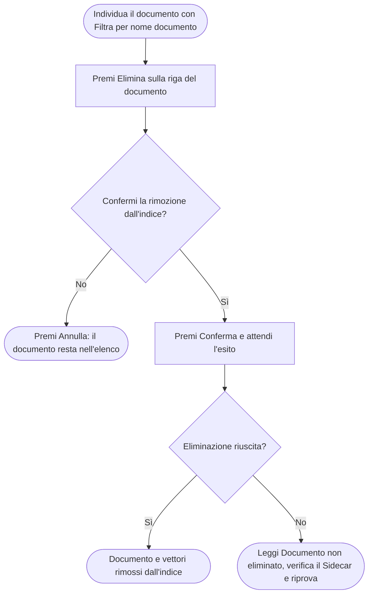


**Percorso testuale.**

1. Individua il documento con **Filtra per nome documento…** e premi l’icona **Elimina** sulla riga.
2. Premi **Conferma** per inviare la cancellazione oppure **Annulla** per lasciare il documento nell’elenco.
3. Con esito positivo documento e vettori non sono più disponibili nell’indice. Con errore leggi **Documento non eliminato**, verifica il Sidecar e riprova.

**Da sapere.** La cancellazione dall’indice non è un comando di cancellazione del file sorgente scelto sul disco né una garanzia di eliminazione di ogni copia conservata. La vista non offre un ripristino del documento eliminato: se serve, importalo nuovamente. In chat deseleziona gli eventuali documenti segnalati come assenti.

## RAG & Chat

### 08 Fare domande con o senza documenti

**Prerequisiti.** Modello Chat disponibile; per il RAG servono anche documenti indicizzati e Sidecar.

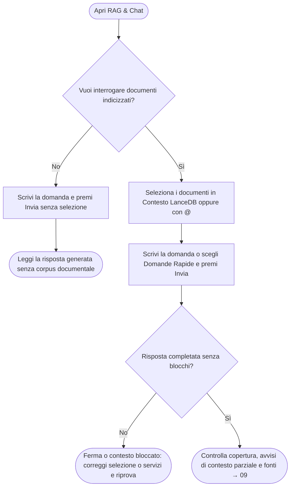


**Percorso testuale.**

1. Per interrogare documenti selezionali in **Contesto LanceDB** o collegali con **@**; **Aggiorna Documenti** aggiorna l’elenco. Senza selezione puoi inviare la domanda, ma non stai interrogando il corpus documentale.
2. Scrivi la richiesta, anche da **Domande Rapide**, e premi **Invia** o **Invio**; **Shift+Invio** aggiunge una riga. **Opzioni Prompt** e **Personalizza System Prompt** consentono di regolare contesto e istruzioni.
3. Durante la generazione usa **Ferma** per interrompere. La risposta risultante è incompleta. In caso di contesto bloccato, selezione assente o servizio indisponibile, correggi il problema e invia nuovamente la domanda.
4. Apri **Contesto documentale inviato per questa risposta** per vedere anteprime e passaggi inclusi, troncati o esclusi; **Testo inviato** mostra il contenuto effettivo di ciascun elemento incluso. Se appare un avviso di contesto parziale, riduci la selezione o fai domande più mirate. Per una risposta completata passa a 09.

**Da sapere.** Il dettaglio riguarda il testo documentale aggiunto in quel turno e resta nella cronologia: l’anteprima è confrontata con il Markdown estratto e il passaggio con il candidato restituito dalla ricerca. Non misura la copertura semantica o i token del modello; lo storico della conversazione può contenere altro contesto precedente. I passaggi fuori dal numero richiesto alla ricerca non sono valutati. Le risposte precedenti all’introduzione del dettaglio non hanno questo riepilogo. Se un modello è in aggiornamento, attendi il completamento. Se un’altra funzione occupa il blocco di esecuzione, termina o interrompi quella lavorazione prima di riprovare. Con runtime remoto i prompt vengono inviati al server configurato in 22.

### 09 Verificare risposta e fonti

**Prerequisiti.** Una risposta con riferimenti o estratti recuperati.

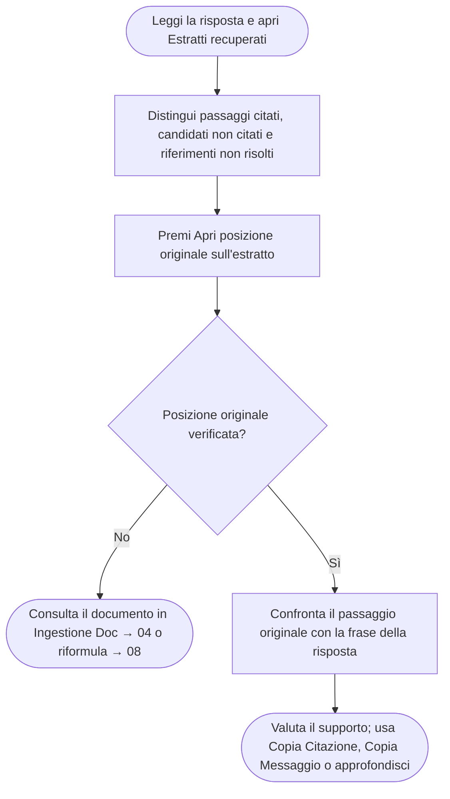


**Percorso testuale.**

1. Distingui i passaggi citati dal modello dai candidati recuperati ma non citati; i riferimenti non risolti non sono supporto verificato.
2. Premi **Apri posizione originale**. Se disponibile e verificata, confronta il passaggio con l’affermazione della risposta. Se non verificabile, consulta il documento da **Ingestione Doc** oppure riformula la domanda.
3. Usa **Copia Citazione** o **Copia Messaggio** per conservare il testo; fai una domanda successiva per chiarire discrepanze.

**Da sapere.** “Posizione originale verificata” conferma la posizione della fonte, non la verità o il supporto della frase generata. Anche “Ordinamento” è un punteggio di ranking, non di certezza.

### 10 Gestire e salvare le conversazioni

**Prerequisiti.** RAG & Chat aperto; cronologia leggibile oppure messaggio di recupero visibile.

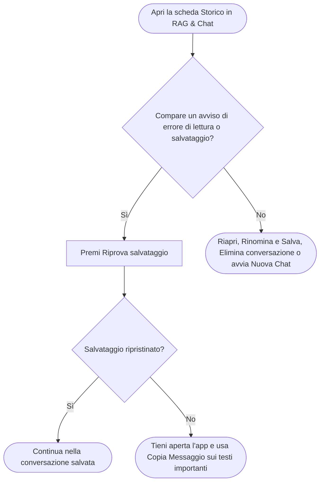


**Percorso testuale.**

1. Nella cronologia seleziona una conversazione per riaprirla, usa **Rinomina** e **Salva** per cambiarne il titolo o **Annulla** per abbandonare la rinomina.
2. **Nuova Chat** crea una conversazione. Nel comando dell’intestazione, se compare la richiesta di azzeramento, **Svuota Chat** apre la nuova conversazione: quella precedente resta nello storico se il salvataggio è riuscito. **Annulla** mantiene aperta la conversazione corrente.
3. **Elimina conversazione** rimuove la conversazione selezionata: non presumere una conferma aggiuntiva o un cestino. Copia prima ciò che serve.
4. Con errore di lettura o salvataggio premi **Riprova salvataggio**. Se persiste, tieni aperta l’app e usa **Copia Messaggio** per conservare il contenuto importante.

**Da sapere.** I nuovi messaggi possono restare solo nella sessione corrente finché la persistenza non viene ripristinata. La domanda attende il checkpoint locale prima della generazione; durante la risposta lo storico viene aggiornato a intervalli. Dopo un riavvio una risposta recuperata prima del completamento mostra un avviso di risposta incompleta. La chiusura normale attende anche lo storico chat; un arresto forzato può perdere il testo successivo all’ultimo checkpoint.

## Traduzione

### 11 Scegliere il tipo di traduzione

**Prerequisiti.** Documento ingerito, modello di traduzione disponibile e nessun altro job di traduzione attivo.

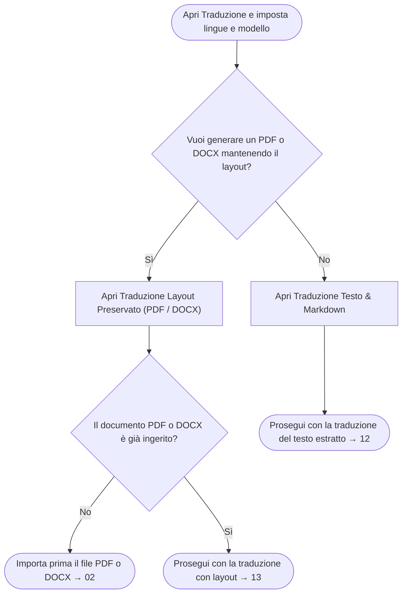


**Percorso testuale.**

1. Per tradurre il testo estratto e confrontarlo nell’editor scegli **Traduzione Testo & Markdown** e passa a 12.
2. Per generare un nuovo PDF o DOCX mantenendo la struttura del documento scegli **Traduzione Layout Preservato (PDF / DOCX)** e passa a 13. Se non c’è un file compatibile, importalo con 02.
3. Imposta **Lingua Sorgente**, **Lingua Destinazione** e un modello esplicito; **Inverti** scambia le lingue. Le due modalità condividono le lingue e consentono un solo job alla volta.

**Da sapere.** Cambiare scheda non annulla un job in corso. Attendi l’esito o usa il comando di interruzione della modalità attiva.

### 12 Tradurre testo e Markdown

**Prerequisiti.** Modalità Traduzione Testo & Markdown, documento e modello selezionati.

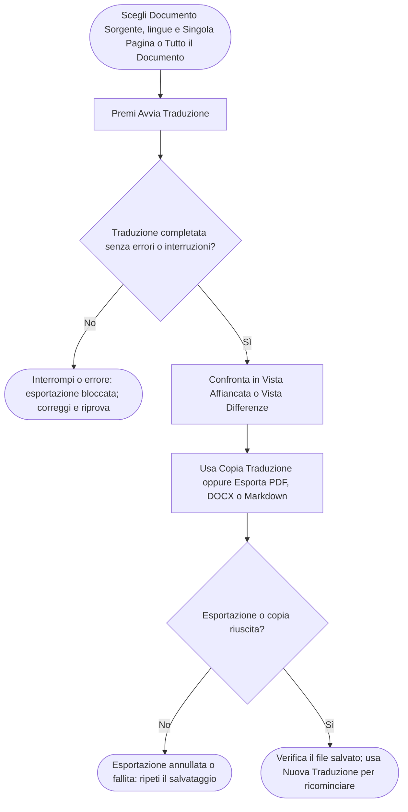


**Percorso testuale.**

1. Seleziona il documento, lingue e modello. Scegli **Singola Pagina** o **Tutto il Documento**: con una sola pagina selezionata traduci quell’ambito, non l’intero documento.
2. Premi **Avvia Traduzione**. **Interrompi** ferma il lavoro; un errore o un risultato incompleto non permette l’esportazione. Correggi la causa e avvia una nuova traduzione.
3. Confronta **Vista Affiancata** e **Vista Differenze**; usa **Scroll Sincronizzato**, zoom e a capo secondo necessità. Controlla che lingua e contenuti siano corretti.
4. Con risultato completo usa **Copia Traduzione**, **Esporta PDF**, **Esporta DOCX** o **Esporta Markdown**. Controlla il messaggio finale: un’esportazione annullata o fallita va ripetuta. **Nuova Traduzione** azzera la selezione e il risultato.

**Da sapere.** Gli export testuali ricostruiscono il documento dal Markdown: non sono il percorso di conservazione del layout originale. Cambiare sorgente, lingue o ambito invalida il completamento precedente; verifica nuovamente la disponibilità dell’esportazione.

### 13 Tradurre PDF o DOCX con layout

**Prerequisiti.** PDF/DOCX ingerito, modello esplicito, cartella di destinazione scelta e job libero.

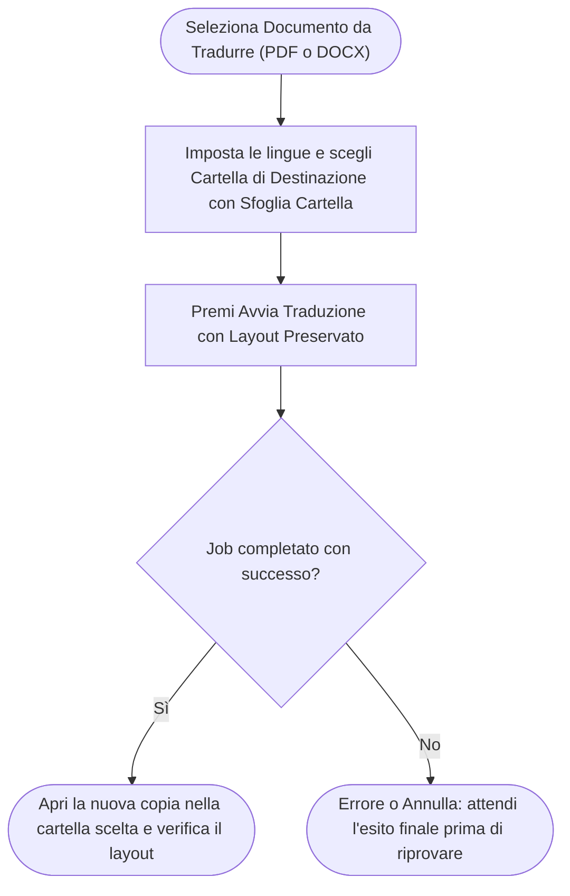


**Percorso testuale.**

1. Scegli un documento PDF o DOCX compatibile e imposta le lingue. Seleziona la **Cartella di Destinazione (Obbligatoria)** con **Sfoglia Cartella…**; **Resetta cartella** rimuove quella scelta.
2. Premi **Avvia Traduzione con Layout Preservato** e segui il progresso. **Annulla** richiede l'interruzione anche prima del primo aggiornamento: attendi il messaggio finale o l'esito della richiesta.
3. Con successo viene indicato il nome della nuova copia nella destinazione scelta. Aprila e confronta testo, tabelle e impaginazione con l’originale.
4. Con errore o annullamento non considerare il lavoro completo. Leggi l’esito prima di riprovare; una richiesta arrivata troppo tardi può incontrare un job già completato.

**Da sapere.** L’originale resta invariato. Le destinazioni devono supportare hard link: una destinazione incompatibile o una collisione con un file già presente viene rifiutata senza sovrascriverlo. Per DOCX sono supportati corpo, tabelle annidate, hyperlink e intestazioni/piè di pagina; campi, textbox, note/commenti e revisioni non supportati vengono rifiutati. Le immagini non ricevono OCR in questo percorso. Lasciare la vista richiede l'annullamento e mantiene il blocco fino all'esito; una perdita di connessione è un errore, non una conferma di cancellazione. Cambiare scheda o chiudere l'app non sostituisce il messaggio finale.

## Coding Agent

### 14 Scegliere progetto e modalità

**Prerequisiti.** Modello Coding disponibile; per lavorare su un progetto esistente scegli la sua cartella.

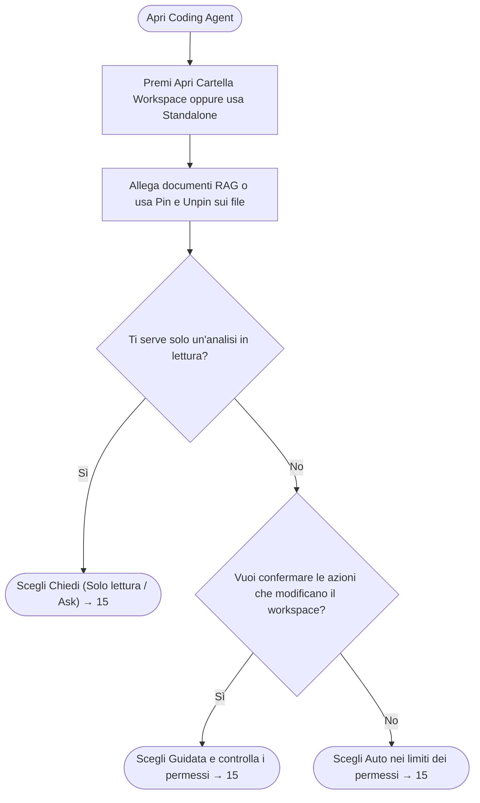


**Percorso testuale.**

1. Usa **Apri Cartella Workspace** per agganciare il progetto; annullare il dialogo non seleziona una nuova cartella. Controlla **Progetto Attivo** prima di inviare richieste. **Standalone** (**Lavoro libero**) indica che non hai agganciato un progetto: da **Workspace Explorer** puoi mostrarne la cartella in Esplora file, esportarne una copia o svuotarla.
2. Scegli **Chiedi** (**Solo lettura / Ask**) per analisi senza modificare file né eseguire comandi; **Guidata** per revisionare le azioni che cambiano il workspace; **Auto** per eseguirle nei limiti dei permessi scelti.
3. Da **Opzioni Prompt** allega documenti ingeriti; usa **Pin** sui file per includerli nel contesto e **Unpin** o la rimozione dell’allegato per escluderli. Configura i permessi con 24 e prepara la richiesta in 15.

**Da sapere.** Il Coding Agent è indicato come sperimentale. Modalità e permessi sono scelte distinte: “Full access e installazioni libere” amplia fortemente i poteri della run, come spiegato in 24; non presumere sempre le protezioni del profilo limitato.

### 15 Pianificare oppure eseguire

**Prerequisiti.** Progetto o Standalone, modello, modalità e contesto scelti in 14. Pianifica è disponibile in Guidata e Auto; in Chiedi usa Avvia Task per l’analisi.

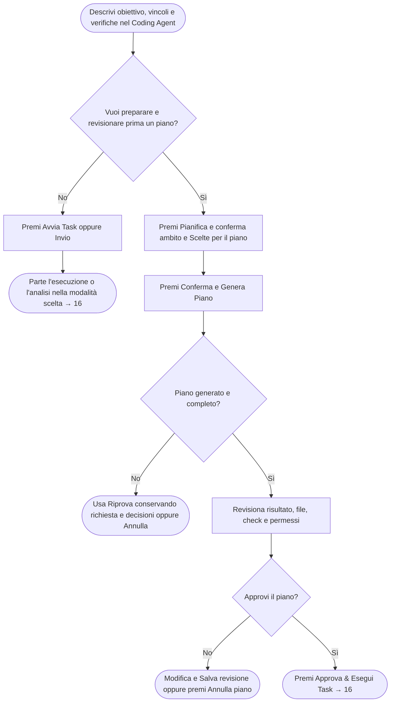


**Percorso testuale.**

1. Scrivi cosa vuoi ottenere, i vincoli e come verificarlo. **Avvia Task** (freccia di invio) o **Invio** avvia la richiesta secondo la modalità corrente; **Pianifica**, disponibile in Guidata e Auto, apre il percorso di preparazione prima dell’esecuzione. In Chiedi usa direttamente Avvia Task per ottenere l’analisi.
2. Se vengono richiesti ambito o **Scelte per il piano**, conferma ogni alternativa oppure usa **Risposta libera**. **Accetta tutti i consigli** è una scelta esplicita; poi premi **Conferma e Genera Piano**.
3. Controlla risultato atteso, decisioni, assunzioni, file, verifiche e permessi. Usa **Modifica risultato, file, check e permessi** e **Salva revisione** per correggere il piano, oppure **Annulla piano** per fermarti.
4. **Approva & Esegui Task** avvia il piano; **Esegui piano approvato** riavvia quello approvato quando disponibile. Con pianificazione incompleta usa **Riprova conservando richiesta e decisioni**; **Annulla** interrompe il flusso di preparazione.

**Da sapere.** Non considerare avviato un piano se salvataggio o preparazione sono falliti. Durante una run, nuove richieste possono andare in coda: controlla la coda e rimuovi quelle non più necessarie prima che vengano eseguite.

Dopo un arresto imprevisto, apri la conversazione e il workspace originali e scegli **Riprendi task** per il lavoro conservato. Se l'esito di un'azione interrotta è ignoto, la ripresa viene rifiutata: usa **Ispeziona prove** per leggere richiesta e stato. Se vuoi chiudere quella run, seleziona la conferma e premi **Abbandona esecuzione**. L'azione non viene ripetuta né annullata; richiesta e prove restano archiviate. Con prove cambiate o salvataggio fallito, ispeziona di nuovo o ripristina lo storage prima di riprovare. Nessun task riparte automaticamente all'avvio.

### 16 Approvare un’azione dell’agente

**Prerequisiti.** Una richiesta avviata oppure una finestra Approvazione Richiesta visibile.

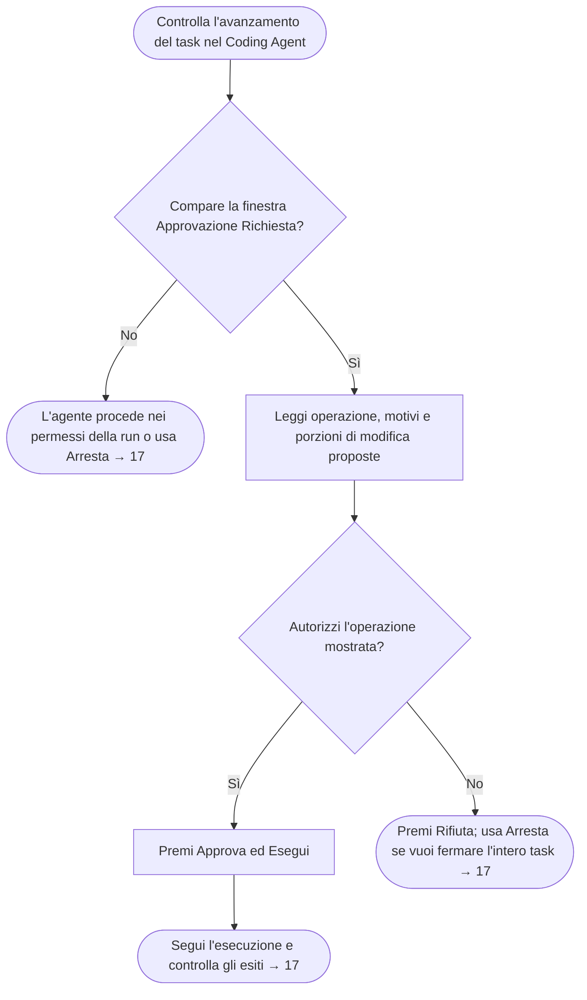


**Percorso testuale.**

1. Quando appare **Approvazione Richiesta**, leggi operazione, motivi e modifiche proposte; seleziona le porzioni approvabili se la finestra le presenta.
2. **Approva ed Esegui** autorizza l’azione mostrata. **Rifiuta** nega quell’azione: controlla i messaggi successivi, perché non equivale necessariamente ad arrestare l’intero task.
3. Se non viene richiesta approvazione, l’esecuzione segue modalità e permessi acquisiti per la run. Per fermare l’attività usa **Arresta** e controlla gli effetti con 17.

**Da sapere.** Rete, installazioni, comandi e commit dipendono dal profilo della run. In particolare Full access può consentire operazioni senza conferma: rileggi 24 prima di attivarlo.

### 17 Controllare esiti e ripristinare file

**Prerequisiti.** Una run completata, fallita o arrestata; eventuale checkpoint disponibile.

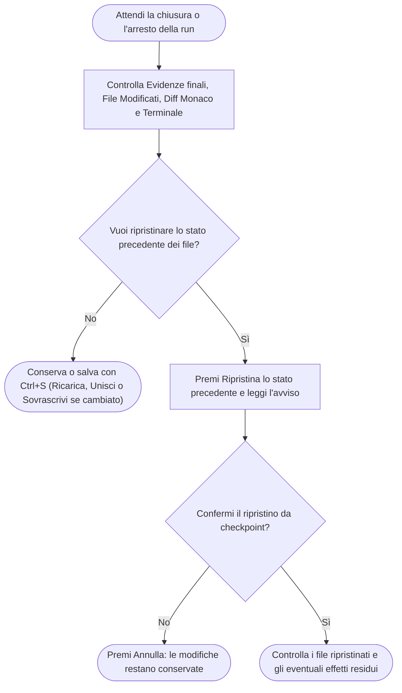


**Percorso testuale.**

1. Durante il task **Arresta** richiede l’interruzione; attendi l’esito. Consulta **Evidenze finali**, **File Modificati**, **Diff Monaco** e l’output del **Terminale**.
2. Distingui una verifica **Superata**, **Fallita** o **Non disponibile**. Una dichiarazione dell’assistente non sostituisce i risultati dei controlli. Per modifiche manuali usa l’editor e **Salva File (Ctrl+S)**; se il file è cambiato su disco nel frattempo, scegli **Ricarica**, **Unisci** o **Sovrascrivi**. Il terminale permette comandi con **Esegui**, soggetti ai controlli applicabili.
3. Se disponibile, **Ripristina lo stato precedente** propone il recupero da checkpoint. Leggi la conferma: riporta i file coperti allo stato precedente e rimuove quelli creati dalla run. Conferma solo se è ciò che vuoi, oppure annulla.
4. Dopo il ripristino controlla conferma, errori ed effetti residui. Se conservi le modifiche, verifica il risultato prima di inviare un’altra richiesta.

**Da sapere.** **Arresta non ripristina automaticamente le modifiche.** Checkpoint e ripristino non garantiscono l’annullamento di comandi shell, installazioni o modifiche esterne al workspace, in particolare con Full access.

### 18 Gestire sessioni e storico progetto

**Prerequisiti.** Un progetto selezionato o una sessione Standalone aperta.

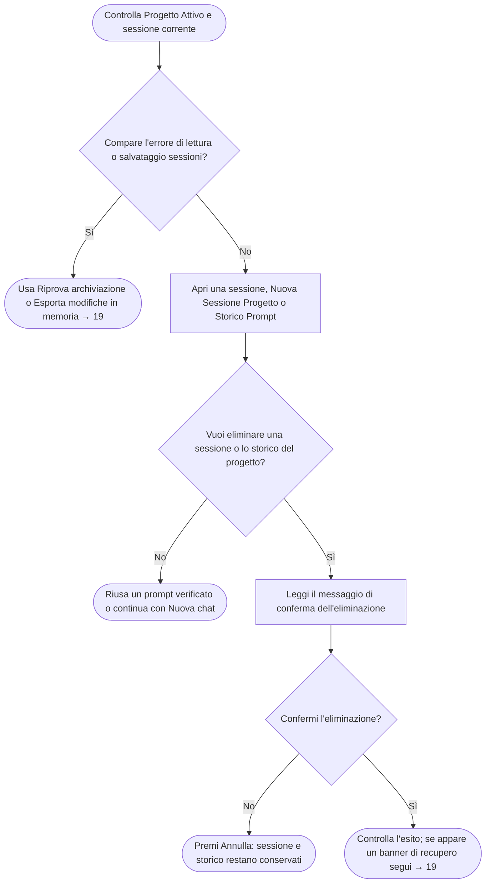


**Percorso testuale.**

1. Nel progetto seleziona una sessione oppure crea una **Nuova Sessione Progetto**; controlla progetto e sessione prima di riusare una richiesta. **Nuova chat** avvia una nuova conversazione nel contesto previsto.
2. Usa **Storico Prompt Progetto** o **Cerca nello storico prompt di tutti i progetti** per trovare richieste e relativi esiti. Rivedi il testo prima di eseguirlo nuovamente.
3. Per eliminare una sessione o **Svuota storico progetto**, leggi e conferma la richiesta mostrata; annulla per conservarla. Controlla il risultato e passa a 19 se compare un avviso di recupero.
4. Con **Impossibile leggere o salvare sessioni o progetti**, tieni aperta la vista e usa **Riprova archiviazione**. Se il salvataggio continua a fallire, **Esporta modifiche in memoria** salva le revisioni non archiviate in una cartella scelta da te: controlla il percorso mostrato. Annullare il dialogo non crea copie; un errore non conferma il salvataggio. L'esportazione conserva una copia separata, ma la chiusura resta bloccata se nessun archivio riconosce le modifiche. I percorsi aggiuntivi di recupero sono in 19.

**Da sapere.** Rimuovere un progetto dall’elenco non è un comando per cancellarne la cartella sul disco. Non confondere l’eliminazione dello storico con il ripristino dei file di lavoro.

### 19 Recuperare storico e cancellazioni

**Prerequisiti.** Un banner di recupero dello storico, di una cancellazione o di un task interrotto è visibile.

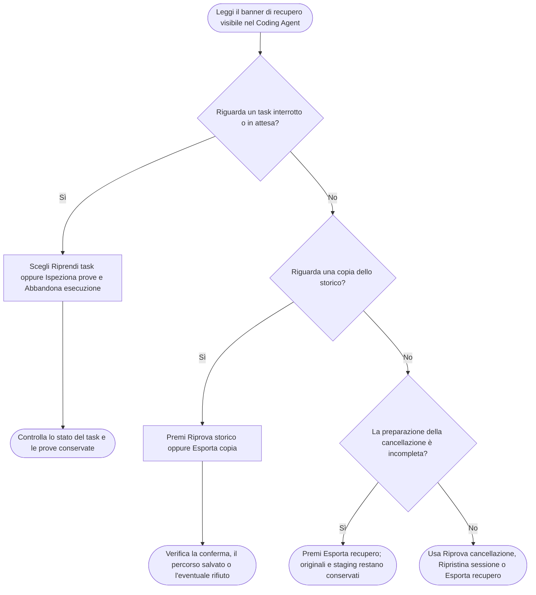


**Percorso testuale.**

1. Se compare l’avviso per task interrotti o in attesa, scegli **Riprendi task** per riprendere con modello e permessi originali oppure **Ispeziona prove**; dopo l’ispezione puoi selezionare la conferma e premere **Abbandona esecuzione** per chiudere il task conservando richiesta e prove.
2. Per una copia dello storico che richiede recupero, scegli **Riprova storico** o **Esporta copia**, seleziona una cartella e controlla il risultato. Annullare il dialogo non crea una copia.
3. Per una cancellazione in attesa, **Riprova cancellazione** è disponibile solo nello stato previsto. **Ripristina sessione** recupera la sessione quando abilitato; **Esporta recupero** conserva una copia per la verifica.
4. Se la preparazione è incompleta, esporta il recupero: riprova e ripristino sono disabilitati. Una cancellazione già completata può ancora esporre la copia conservata per ripristino o esportazione.
5. Dopo ogni azione controlla conferma o errore e il percorso indicato. Se il recupero viene rifiutato, conserva i dati; **Mostra altre operazioni di recupero** visualizza eventuali record aggiuntivi.

**Da sapere.** L’export del banner riguarda una copia di recupero già disponibile. Se falliscono sia salvataggio sia recupero, usa **Esporta modifiche in memoria** dal percorso 18 e verifica l'esito; se anche l'export fallisce, conserva aperta la vista e copia quanto puoi. Un'esportazione separata non conferma il salvataggio canonico e non rimuove il blocco della chiusura.

### 20 Gestire skill e sorgenti

**Prerequisiti.** Workspace scelto; per cataloghi e importazioni esterne serve accesso alla rete.

```mermaid
flowchart TD
  S(["Apri Skill Hub & Marketplace"]) --> Q1{"La skill che ti serve è già in Skill Installate?"}
  Q1 -- "Sì" --> A1["Leggi o copia le istruzioni; modifica, Ripristina Originale o Elimina"]
  A1 --> R1(["Controlla il messaggio di conferma e torna al task → 15"])
  Q1 -- "No" --> A2["Scegli Marketplace & Hub, Importa da URL, Crea Skill o Aggiungi Hub"]
  A2 --> A3["Esamina origine e istruzioni Markdown prima di Installa o Salva"]
  A3 --> Q2{"Installazione o salvataggio riusciti?"}
  Q2 -- "Sì" --> R2(["Controlla Skill Attive e usa la skill nel Coding Agent → 15"])
  Q2 -- "No" --> E1(["Leggi l'errore o l'annullamento: la skill non è ancora attiva"])
```


**Percorso testuale.**

1. Apri **Skill Hub**. In **Skill Installate** puoi cercare, leggere e copiare le istruzioni, modificarle, usare **Ripristina Originale** quando disponibile o confermare **Elimina**.
2. Per aggiungere capacità usa **Marketplace & Hub** e **Installa**, **Importa da URL** con un documento SKILL.md, oppure **Crea Skill** con nome, descrizione, trigger e istruzioni. Leggi il contenuto prima di salvarlo o installarlo.
3. **Aggiungi Hub** aggiunge una sorgente personalizzata; la rimozione della sorgente ha una conferma distinta. Non equivale alla rimozione delle skill già installate.
4. Con discovery attiva, se l’agente propone una skill, scegli **Installa** oppure **Rifiuta** nella richiesta. Se fallisce, leggi l’errore; se annulli la creazione o l’importazione, torna alle skill senza considerare completato l’inserimento.

**Da sapere.** Le skill contengono istruzioni per l’agente, non una certificazione del risultato. La presenza di una skill installata non significa che sia attiva in ogni task: controlla **Skill Attive**.

## Impostazioni

### 21 Preferenze, cartelle e prompt

**Prerequisiti.** Impostazioni caricate; nessun errore di lettura iniziale.

```mermaid
flowchart TD
  S(["Apri Impostazioni"]) --> A1["Regola Lingua Interfaccia, A capo automatico, Excel, suoni e cartelle"]
  A1 --> Q1{"Vuoi personalizzare un System Prompt?"}
  Q1 -- "Sì" --> A2["Apri System Prompt nella funzione, controlla l'anteprima e premi Salva"]
  A2 --> Q2{"Compare Impostazioni salvate senza errori?"}
  Q1 -- "No" --> Q2
  Q2 -- "Sì" --> R1(["Torna alla funzione operativa e verifica l'effetto"])
  Q2 -- "No" --> E1(["Correggi gli errori del prompt o premi Riprova tenendo aperta l'app"])
```


**Percorso testuale.**

1. In **Preferenze & Interfaccia Utente** regola **Lingua Interfaccia**, a capo ed **Effetti Sonori**. **Excel: dimensioni del formato** amplia le dimensioni ammesse per la richiesta di ingestione; l’estratto RAG resta limitato.
2. In **Directory e File di Output** scegli la **Cartella Output Traduzioni** con **Sfoglia…**. **Rimuovi** elimina la preferenza della cartella, non i file già esportati. **Apri Cartella Log** apre la cartella dei log.
3. Per personalizzare le istruzioni apri **System Prompt** nella funzione interessata, seleziona il prompt, rivedi testo e anteprima e premi **Salva**. Correggi gli errori che bloccano il salvataggio; chiudi per abbandonare la bozza non salvata. **Ripristina default** rimuove una personalizzazione dopo conferma.
4. Le preferenze si salvano automaticamente: controlla **Impostazioni salvate**. Con errore usa **Riprova** e attendi la conferma prima di chiudere.

**Da sapere.** La lingua dell’interfaccia e la lingua di destinazione della traduzione sono scelte separate. La persistenza di una modifica durante chiusura o interruzione non è garantita senza conferma di salvataggio.

### 22 Scegliere e collegare Ollama

**Prerequisiti.** Impostazioni accessibili; per il percorso remoto conosci il server da usare.

```mermaid
flowchart TD
  S(["Apri Server Ollama (Locale o Rete) nelle Impostazioni"]) --> Q1{"Eseguire Ollama sullo stesso PC?"}
  Q1 -- "Sì" --> A1["Scegli Sullo stesso PC (Locale); usa Avvia / Installa Ollama se serve"]
  Q1 -- "No" --> A2["Scegli Server in Rete Remoto e inserisci l'indirizzo del server"]
  A1 --> A3["Premi Test Connessione Server"]
  A2 --> A3
  A3 --> Q2{"Connessione riuscita?"}
  Q2 -- "Sì" --> R1(["Passa a Modelli, assegnazioni e OCR → 23"])
  Q2 -- "No" --> E1(["Controlla servizio, indirizzo e porta; poi usa Test o Riprova server"])
```


**Percorso testuale.**

1. In **Server Ollama (Locale o Rete)** scegli **Sullo stesso PC (Locale)** oppure **Server in Rete Remoto** e inserisci il relativo indirizzo.
2. Nel percorso locale **Avvia / Installa Ollama** tenta l’avvio del processo. Se apre la pagina ufficiale, completa manualmente download e installazione nel browser; poi ripeti il controllo.
3. Premi **Test Connessione Server**. Con esito positivo passa a 23; se non raggiungibile controlla servizio, indirizzo e accessibilità della porta, quindi riprova. In modalità remota puoi anche usare **Riprova server** o **Configura server** nella barra laterale.

**Da sapere.** L’apertura della pagina di download o l’avvio del processo non provano che il server sia pronto. Il percorso remoto invia prompt e dati delle richieste al server scelto: per elaborazione sul solo dispositivo usa il percorso locale.

### 23 Modelli, assegnazioni e OCR

**Prerequisiti.** Ollama raggiungibile; rete disponibile per nuovi download o aggiornamenti.

```mermaid
flowchart TD
  S(["Apri Modelli AI & Assegnazione per Modulo"]) --> Q1{"I modelli necessari sono già installati?"}
  Q1 -- "No" --> A1["Usa Setup Wizard Hardware & Modelli oppure Scarica Modello"]
  A1 --> Q2{"Download o aggiornamento completato?"}
  Q2 -- "No" --> E1(["Leggi l'errore e riprova; non usare un modello non installato"])
  Q2 -- "Sì" --> A2["Assegna i modelli ai moduli e scegli il motore OCR"]
  Q1 -- "Sì" --> A2
  A2 --> A3["Regola contesto, Thinking e Campionamento dove disponibili"]
  A3 --> R1(["Attendi Impostazioni salvate e torna alla funzione → 00"])
```


**Percorso testuale.**

1. Usa **Setup Wizard Hardware & Modelli** per esaminare hardware e proposte oppure inserisci il nome in **Scarica Modello**. Attendi l’esito; con errore correggi la causa e riprova.
2. Assegna i modelli ai ruoli richiesti: Coding, Chat/RAG, Traduzione, Vision/OCR ed Embedding; quelli specialistici sono opzionali. Un modello selezionato ma non installato non è pronto all’uso.
3. Scegli **OCR Nativo (RapidOCR / ONNX)** o **Vision LLM Multimodale (Ollama Vision)**. L’OCR nativo mostra `GPU ON` / `RapidOCR (CUDA)` o `CPU` / `RapidOCR (CPU)` solo con Sidecar online (`provider in verifica` in avvio o offline); un eventuale ripiego interno a CPU dopo un avvio CUDA non riuscito non aggiorna ancora l’indicatore diagnostico ([`ingestion.md`](./ingestion.md)). Regola contesto e, dove disponibili, Thinking e Campionamento per il Coding Agent.
4. **Verifica Aggiornamenti** cerca nuove versioni; **Update now** le scarica. Attendi la fine prima di usare un modello in aggiornamento. **Scarica RAM** libera il modello in esecuzione; **Elimina Modello** richiede conferma e ne rimuove i pesi.
5. Dopo download o modifica aggiorna l’elenco, controlla le assegnazioni e la conferma di salvataggio, quindi torna alla funzione.

**Da sapere.** Se cambi il modello di embedding, l’indice esistente non diventa automaticamente compatibile: non presumere una ricostruzione dall’interfaccia. La manutenzione richiede un percorso separato con backup, descritto nella guida tecnica alle operazioni. Le stime hardware e i badge non garantiscono qualità o autonomia sul tuo task.

### 24 Permessi e limiti dell’agente

**Prerequisiti.** Impostazioni caricate; per modificare i permessi di un piano, un piano pronto è aperto.

```mermaid
flowchart TD
  S(["Apri Permessi Agent Coding o Permessi agente"]) --> A1["Scegli Predefiniti per le nuove run oppure Piano corrente"]
  A1 --> Q1{"Vuoi attivare Full access e installazioni libere?"}
  Q1 -- "Sì" --> A2["Leggi l'avviso sugli effetti fuori dal progetto e attiva l'opzione"]
  Q1 -- "No" --> A3["Imposta Modifiche ai file, Comandi terminale, Rete e Budget di step"]
  A2 --> A4["Premi Salva permessi del piano se stai modificando un piano"]
  A3 --> A4
  A4 --> Q2{"Permessi salvati senza errori?"}
  Q2 -- "Sì" --> R1(["Procedi a pianificare o eseguire il task → 15"])
  Q2 -- "No" --> E1(["Ripeti il salvataggio: i permessi non salvati non sono applicati"])
```


**Percorso testuale.**

1. In **Permessi Agent Coding** scegli i predefiniti per le nuove run; dal Coding Agent **Permessi agente** permette di distinguere i predefiniti dal **Piano corrente**. Se il piano non è pronto, i relativi controlli non sono disponibili.
2. Nel profilo limitato imposta **Modifiche ai file**, **Comandi terminale** e **Rete** (**Bloccata**, **Solo locale**, **Con approvazione**). Imposta il **Budget di step** o scegli esplicitamente **Illimitato**. Salva i permessi del piano quando richiesto e controlla l’esito.
3. **Full access e installazioni libere** consente azioni più ampie, incluse modifiche fuori dal progetto, comandi, installazioni e commit senza conferme previste dal profilo limitato. Leggi il testo dell’opzione prima di attivarla; per conservare limiti espliciti lasciala disattivata.
4. Per esaminare un problema e gestire i log segui il percorso 25.
5. Se il salvataggio fallisce usa la riprova disponibile; non considerare applicati i permessi di un piano non salvato. Le scelte della run attiva non cambiano retroattivamente modificando i predefiniti.

**Da sapere.** Con Full access i checkpoint coprono solo i file tracciati nel workspace: modifiche esterne e comandi shell non hanno ripristino garantito.

### 25 Diagnosticare un problema e gestire i log

**Prerequisiti.** Un errore da esaminare; conserva i dati di lavoro prima di riprodurlo.

```mermaid
flowchart TD
  S(["Apri Console Log, Apri Cartella Log o Diagnostica del Coding Agent"]) --> A1["Controlla stato dei servizi, filtra i log o usa Riavvia Sidecar"]
  A1 --> Q1{"Servono dettagli aggiuntivi sulle prossime run dell'agente?"}
  Q1 -- "No" --> R0(["Usa Copia Report se utile, correggi la causa e riprova"])
  Q1 -- "Sì" --> A2["Attiva Log Debug Coding Agent e scegli File conservati"]
  A2 --> A3["Riproduci solo il problema necessario ed esamina i log raccolti"]
  A3 --> Q2{"Vuoi svuotare il log di audit dell'agente?"}
  Q2 -- "No" --> R1(["Conserva i log, correggi la causa dell'errore e riprova"])
  Q2 -- "Sì" --> A4["Copia prima quanto serve e premi Pulisci log agente"]
  A4 --> R2(["Verifica il segno di conferma accanto a Pulisci log agente"])
```


**Percorso testuale.**

1. Apri **Console Log** dalla barra laterale, **Apri Cartella Log** dalle Impostazioni oppure la diagnostica del Coding Agent per leggere stato, risorse ed errori. In **Console Log** puoi filtrare per testo, livello o modulo, usare **Copia Report**, **Pulisci Log** (che azzera il buffer della console) o **Riavvia Sidecar** quando il Sidecar risulta offline.
2. Per registrare ulteriori dettagli delle prossime run attiva **Log Debug Coding Agent** e scegli **File conservati**. Riproduci soltanto il problema necessario e consulta i dati raccolti; attivare il debug non recupera payload che non erano stati registrati.
3. Conserva i log se ti servono per correggere la causa e riprovare. Se vuoi pulire il log di audit dell’agente, copia prima quanto serve e premi **Pulisci log agente**: la pulizia parte senza una seconda conferma.
4. Controlla il segno di conferma accanto al pulsante. Se manca, non dare per riuscita la pulizia. Chiudere la console non cancella il log e pulire il log non corregge la causa dell’errore.

Per identificare la build consulta **Informazioni**. Le versioni riportate sono la baseline del pacchetto costruito; non provano la versione del server Ollama o di un Sidecar esterno. Il comando delle licenze apre notice e dettagli dei sorgenti associati all'ambiente.

**Da sapere.** Il debug registra passaggi, prompt, sorgenti e risposte, con credenziali oscurate. Percorsi e contenuti possono restare presenti: controlla le copie prima di condividerle. I log operativi e l’audit dell’agente sono distinti; Pulisci log agente agisce su quest’ultimo.

## Riferimenti e limiti di verifica

Per i comportamenti documentali e i limiti noti consulta [Ingestion e OCR](./ingestion.md), [Ricerca e fonti](./retrieval.md), [Traduzione](./translation.md), [Coding Agent](./coding-agent.md), [Interfaccia e salvataggi](./frontend.md) e [Operazioni](./operations.md). Lo [stato delle verifiche](./verification-current.md) distingue prove isolate e qualificazione dell’app installata.

Le etichette sono confrontate con la [localizzazione italiana](../src/i18n/locales/it.ts). I percorsi sono ricavati dalle viste [Ingestione](../src/components/ingestion/IngestionView.tsx), [Chat](../src/components/chat/ChatView.tsx), [Traduzione](../src/components/translation/TranslationView.tsx), [Coding Agent](../src/components/coding/CodingAgentView.tsx) e [Impostazioni](../src/components/settings/SettingsView.tsx), con i rispettivi hook e pannelli. In particolare: [importazione e salvataggio](../src/hooks/useIngestion.ts), [generazione chat](../src/hooks/useChatEngine.ts), [traduzioni e annullamento](../src/hooks/useTranslation.ts), [approvazione dei piani](../src/hooks/usePlanApproval.ts), [permessi](../src/components/coding/AgentCapabilityProfileControls.tsx), [recupero storico](../src/components/coding/CodingHistoryRecoveryBanner.tsx) e [recupero cancellazioni](../src/components/coding/SessionDeletionRecoveryBanner.tsx).

Questa guida non esegue operazioni sui dati. Per ricostruire indici, intervenire su archivi personali o effettuare manutenzione segui le istruzioni dedicate, con le relative copie di sicurezza. I flussi descritti non richiedono nuove chiamate ai modelli per essere consultati.
